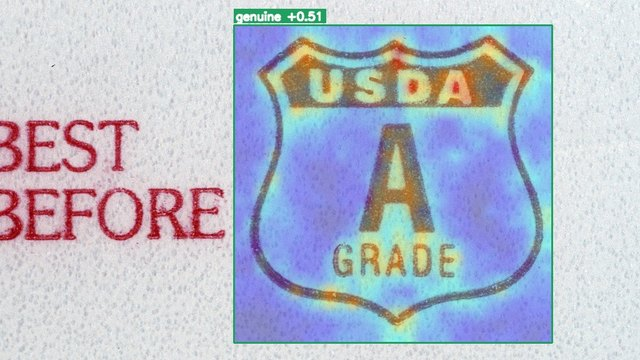
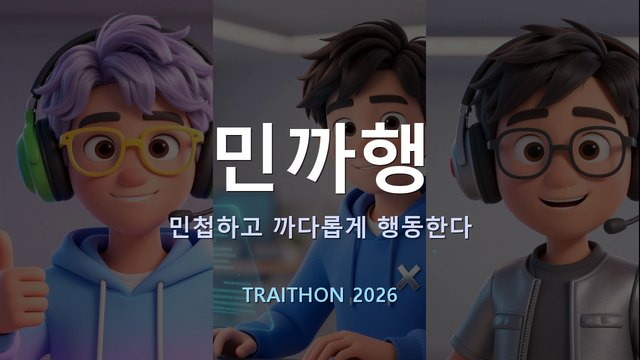
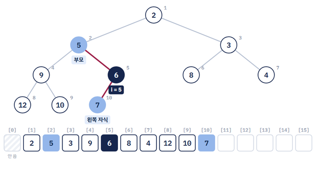
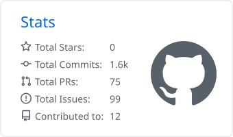
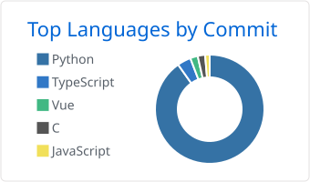

## 🚀 지금 하는 일

- 💼 **딥뉴로텍** AI 개발자 — 주차장 다중 CCTV 영상을 관제·분석하는 중앙 AI Agent를 개발하고 있어요
- 🧑‍🏫 한국외대 「알고리즘설계와해석」 **코딩존 조교** — 실습용 인터랙티브 발표자료를 직접 만들어 진행해요
- 🔬 **진행 중인 프로젝트** — 한국어 명령 파서 · 현장형 민원 분류·보류 · AI 발음 코치 UI/UX 제안
- 🧠 **VLM**(Vision-Language Model)과 **AI Agent**에 관심이 많습니다

## ⭐ 대표 프로젝트

<table>
<tr>
<td width="33%" valign="top">

<b><a href="https://github.com/oks706/logoguard">🛡️ LogoGuard</a></b>

진품 로고만 학습해 위조를 잡아내는 One-Class 앙상블 탐지기

PyTorch · YOLO26 · CLIP · Gradio ✅ <a href="https://github.com/oks706/logoguard/releases/tag/v0.1.0">v0.1.0 공개</a>

</td>
<td width="33%" valign="top">

<b><a href="https://github.com/oks706/minkkahaeng-ai-intro">🎬 민까행 AI 팀 소개영상</a></b>

게이밍 PC 한 대의 로컬 AI만으로 캐릭터·애니메이션·음악·더빙까지 만드는 30초 영상 파이프라인

Z-Image · Wan2.2 · Stable Audio · Qwen3 TTS ✅ TRAITHON 2026 출품

</td>
<td width="33%" valign="top">

<b><a href="https://github.com/oks706/algorithm-coding-zone">🧑‍🏫 코딩존 실습 발표자료</a></b>

정렬·탐색·힙을 한 단계씩 따라가 보는 인터랙티브 HTML 슬라이드

HTML · JavaScript · Python 🚧 4회차 공개

</td>
</tr>
</table>

<b>📂 전체 프로젝트 보기 (9개)</b>

 

| 프로젝트 | 설명 | 기술 | 상태 |
|---|---|---|:---:|
| 🛡️ **[LogoGuard](https://github.com/oks706/logoguard)** | 진품 로고만 학습해 위조를 잡아내는 One-Class 앙상블 탐지기. YOLO26로 로고를 찾고 EfficientAD·FE-CLIP 앙상블로 이상도를 판정합니다 | PyTorch · YOLO26 · CLIP · Gradio | ✅&nbsp;[v0.1.0](https://github.com/oks706/logoguard/releases/tag/v0.1.0)&nbsp;공개 |
| 🅿️ **주차장 CCTV Agent** (딥뉴로텍) | 주차장 다중 CCTV 영상을 관제·분석하는 중앙 AI 에이전트. OCR 번호판 인식, 카메라 간 차량 전역 ID 추적 | Python · VLM · OCR · Multi-Agent | 🚧&nbsp;진행&nbsp;중 |
| 🎮 **한국어 명령 파서** (딥러닝 팀 프로젝트) | 한국어 음성·텍스트 명령을 게임 API 호출열로 바꾸는 언어모델 파트 담당. 토크나이저와 110M GPT 사전학습부터 ONNX 내보내기, Unity C# 파서까지 직접 구현해 서버 없이 게임 안에서 동작 | Python · GPT · ONNX · Unity(C#) · Whisper | 🚧&nbsp;진행&nbsp;중 |
| 🏛️ **현장형 민원 분류·보류** (팀 연구) | 민원 음성을 Whisper로 받아 적고 분야를 분류하되, 애매하거나 지원하지 않는 요청은 보류하는 선택적 분류. KLUE-RoBERTa·Granite 비교, Jetson Orin Nano에서 지연·메모리·에너지 실측 | PyTorch · Whisper · KLUE-RoBERTa · TensorRT · Jetson | 🚧&nbsp;진행&nbsp;중 |
| 🧑‍🏫 **[코딩존 실습 발표자료](https://github.com/oks706/algorithm-coding-zone)** | 정렬·탐색·힙·Huffman·Kruskal을 단계별 애니메이션과 시뮬레이터로 보여주는 HTML 슬라이드. 오프라인 글꼴 내장 | HTML · JavaScript · Python | 🚧&nbsp;4회차&nbsp;공개 |
| 🗣️ **AI 발음 코치 UI/UX 제안** | AI 외국어 학습 앱 디자인 개선 제안 공모전 출품용. 따라 말하기 → 억양 비교·항목별 점수 → 단어 교정 팁 → 복습으로 이어지는 발음 학습 흐름을 HTML 프로토타입과 기획서로 제안 | HTML · JavaScript · UX 기획 | 🚧&nbsp;진행&nbsp;중 |
| 🎬 **[민까행 AI 팀 소개영상](https://github.com/oks706/minkkahaeng-ai-intro)** | TRAITHON 2026 출품. 클라우드 API 없이 게이밍 PC 한 대의 로컬 AI만으로 캐릭터·애니메이션·음악·한국어 더빙까지 만드는 30초 영상 파이프라인 | Z-Image · Wan2.2 · Stable Audio · Qwen3 TTS | ✅&nbsp;공개 |
| ⚾ **LG Aimers × LG 트윈스 해커톤** | 투수의 다음 투구 제구 성공 확률 예측 모델 | Python · ML | ✅&nbsp;완료 |
| 📅 **[Hufs_Time](https://github.com/oks706/Hufs_Time)** | 한국외대 수강 시간표 빌더. 강의 데이터 스크래핑 후 시간표 조합 | Vue · Node.js · PostgreSQL · Docker/K8s | ✅&nbsp;완료 |

> 🔒 비공개 프로젝트는 공개 전환 시 저장소 링크가 추가됩니다.

## 🔧 기술 스택

| 분야 | 기술 |
|---|---|
| **AI&nbsp;·&nbsp;Vision** |       |
| **Web&nbsp;·&nbsp;인프라** |         |
| **언어&nbsp;·&nbsp;도구** |       |

## 🎓 수료 & 자격증

| 구분 | 이름 | 기관 | 시기 | 인증 |
|:---:|---|---|:---:|:---:|
| 수료 | LG Aimers 9기 (Phase 1&2) | LG경영개발원 AI연구원 · 고용노동부 | 2026.09 | - |
| 수료 | AI Fundamentals | Google · Coursera | 2026.07 | [✅ 확인](https://coursera.org/verify/GPTT7C0TKJA9) |
| 수료 | AI for Brainstorming and Planning | Google · Coursera | 2026.07 | [✅ 확인](https://www.coursera.org/account/accomplishments/verify/5CODHCP4W6KX) |
| 수료 | GameAIfy Contest (AI 게임 제작 공모전) | 앵커노드 | 2025.09 | - |

## 📊 GitHub

<picture>
  <source media="(prefers-color-scheme: dark)" srcset="https://raw.githubusercontent.com/oks706/oks706/main/profile-summary-card-output/github_dark/3-stats.svg" />
  
</picture>
<picture>
  <source media="(prefers-color-scheme: dark)" srcset="https://raw.githubusercontent.com/oks706/oks706/main/profile-summary-card-output/github_dark/2-most-commit-language.svg" />
  
</picture>

<picture>
  <source media="(prefers-color-scheme: dark)" srcset="https://raw.githubusercontent.com/oks706/oks706/output/github-snake-dark.svg" />
  <source media="(prefers-color-scheme: light)" srcset="https://raw.githubusercontent.com/oks706/oks706/output/github-snake.svg" />
  
</picture>

